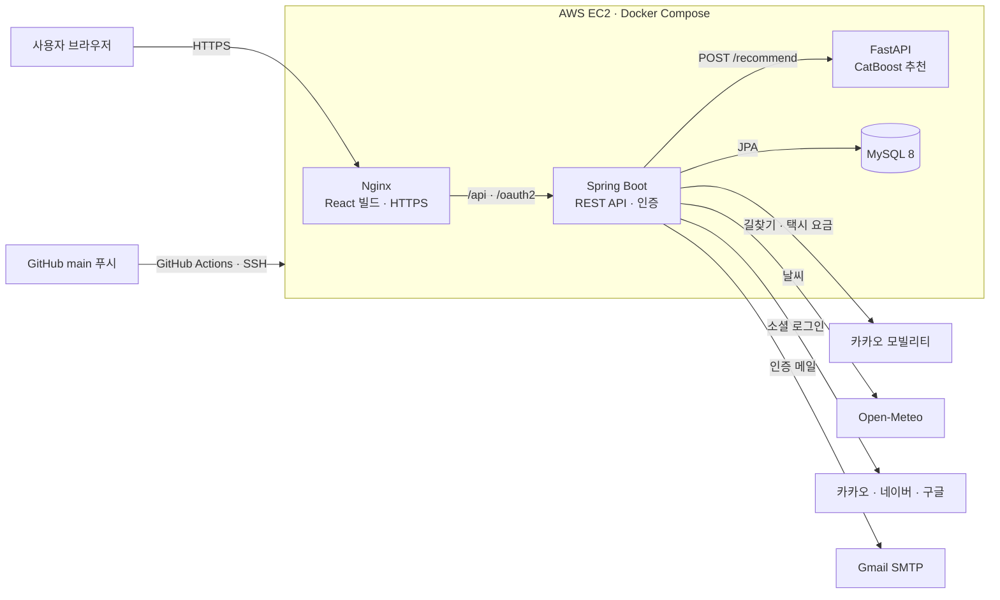
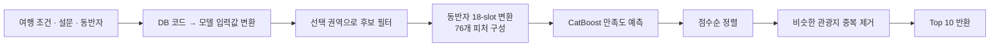

# 🍊 Jejuro (제주로)
여행 조건과 취향을 바탕으로 AI가 제주 관광지를 추천하고, 날짜별 일정과 이동 경로까지 함께 계획하는 서비스
## 🧳LOGO


## 👥 팀 소개

<table>
  <tr>
    <td align="center" width="50%">
      <a href="https://github.com/LEEYEWIN">
        <br>
        <b>이예원</b>
      </a><br>
      <sub>팀장 · AI</sub>
    </td>
    <td align="center" width="50%">
      <a href="https://github.com/hamzzy-oao">
        <br>
        <b>김현지</b>
      </a><br>
      <sub>Backend · DevOps</sub>
    </td>
  </tr>
  <tr>
    <td valign="top">
      <sub>
      · 추천 모델(CatBoost) 재학습<br>
      · FastAPI 추천 서버<br>
      · 회원가입 및 로그인 기능 구현
      · 회원가입 시 이메일 SMTP 기능 구현
      </sub>
    </td>
    <td valign="top">
      <sub>
      · Spring Boot API<br>
      · AI 서버 연동<br>
      · Docker · AWS 배포, HTTPS 적용<br>
      · GitHub Actions 자동 배포
      </sub>
    </td>
  </tr>
</table>

## 📅 개발기간
 2026년 09월 12일 ~ 2026년 10월 18일

## 🛠 기술 스택

<table>
  <tr>
    <td align="center" width="25%"></td>
    <td align="center" width="25%"></td>
    <td align="center" width="25%"></td>
    <td align="center" width="25%"></td>
  </tr>
  <tr>
    <td align="center" valign="top">
      <br>
      <sub>화면 · 단계별 입력 · 일정 편집</sub><br><br>
      <br>
      <sub>React Router · Axios</sub><br><br>
      <br>
      <sub>지도 · 마커 · 경로선</sub>
    </td>
    <td align="center" valign="top">
      <br>
      <sub>업무 규칙 · REST API</sub><br><br>
      <br>
      <sub>세션 로그인 · CSRF · OAuth2</sub><br><br>
      <br>
      <sub>트랜잭션 · 엔티티 매핑</sub>
    </td>
    <td align="center" valign="top">
      <br>
      <sub>/recommend 추천 API</sub><br><br>
      <br>
      <sub>275곳 × 입력 76개 점수</sub><br><br>
      <br>
      <sub>특성 변환 · 후보 정렬</sub>
    </td>
    <td align="center" valign="top">
      <br>
      <sub>테이블 31개 · 뷰 · 트리거 · 프로시저</sub>
    </td>
  </tr>
</table>

<table>
  <tr>
    <td align="center" width="20%"><b>외부 연동</b></td>
    <td align="center">
      
      
      
      
    </td>
  </tr>
</table>

## 🎯기획의도
<table>
  <tr>
    <th width="46%">근거</th>
    <th width="8%"></th>
    <th width="46%">반영한 기능</th>
  </tr>
  <tr>
    <td>
      <sub><b>근거 01</b></sub><br>
      <b>여행 계획 자체가 스트레스</b><br>
      <sub>Zehrer &amp; Crotts (2012) · 준비·계획을 "출발 전 스트레스" 요인으로 분류</sub>
    </td>
    <td align="center">➜</td>
    <td>
      <b>추천 → 담기 → 날짜별 배치를 한 흐름으로</b><br>
      <sub>여행 만들기 3단계 · 경로 자동 저장 · 방문 순서 추천</sub>
    </td>
  </tr>
  <tr>
    <td>
      <sub><b>근거 02</b></sub><br>
      <b>선택지가 많을수록 결정이 어렵다</b><br>
      <sub>Shin 외 (2025) · 실험 5개 · 사람과 AI가 함께 고를 때 결과가 가장 좋음</sub>
    </td>
    <td align="center">➜</td>
    <td>
      <b>AI가 좁히고, 최종 결정은 사용자가</b><br>
      <sub>275곳 → 10곳 추천 · 담기 · 빼기 · 관심없음</sub>
    </td>
  </tr>
  <tr>
    <td>
      <sub><b>근거 03</b></sub><br>
      <b>제주는 스스로 짜는 여행이 대부분</b><br>
      <sub>2025 제주 방문관광객 실태조사 · 개별여행 96.8% · 3년 재방문 90.1%</sub>
    </td>
    <td align="center">➜</td>
    <td>
      <b>추천과 기록의 단위를 "한 번의 여행"으로</b><br>
      <sub>회원당 여러 여행 · 여행마다 동행자 · 설문 · 후기 따로 저장</sub>
    </td>
  </tr>
</table>

## 📍ERD


## 🔥트러블슈팅

<details>
<summary><b>자동 저장 시 다른 탭의 수정 내용을 덮어쓰는 문제 → 버전 비교 + 409 충돌 처리</b></summary>

<br>

**🚨 문제**
- 경로 짜기 화면은 장소를 옮길 때마다 **자동 저장**한다.
- 같은 여행을 두 탭에서 열고 각각 수정하면, **나중에 저장한 탭이 먼저 저장한 내용을 말없이 덮어써** 수정한 내용이 사라짐

**🔍 원인**
- 저장 요청이 "어떤 상태를 보고 수정했는지"를 서버에 알려 주지 않아, 서버는 **오래된 화면에서 보낸 요청인지 구분할 수 없음**
- 같은 저장 요청이 거의 동시에 두 번 들어오면 처리 순서도 보장되지 않음

**🛠 해결**
1. **경로 버전 만들기**
   - 경로 내용(이름 · 일차 · 방문 순서)을 SHA-256 해시로 만든 `version`을 조회 응답에 포함
   - DB에 칼럼을 추가하지 않아도, 내용이 바뀌면 값이 자동으로 바뀜
2. **저장할 때 버전 비교**
   - 화면이 마지막으로 받은 `baseVersion`을 함께 보내고, 서버의 현재 버전과 다르면 **409 Conflict** 반환
   - 화면은 자동 저장을 멈추고 "다른 탭에서 먼저 바뀌었어요. 최신 경로를 불러와 주세요"라고 안내
3. **동시 요청 차례로 처리**
   - 저장을 시작할 때 여행 행을 `SELECT … FOR UPDATE`로 잠가, 같은 요청이 동시에 와도 하나씩 처리

**✅ 결과**
- 여러 탭에서 수정해도 **데이터가 말없이 사라지지 않음**
- 사용자가 충돌이 났다는 것을 바로 알고, 최신 경로를 불러와 이어서 수정할 수 있음

**💡 배운 점**
- 자동 저장처럼 요청이 잦은 기능은 "마지막 요청이 이긴다"는 방식이 데이터 유실로 이어질 수 있다.
- 클라이언트가 **어떤 버전을 기준으로 수정했는지**를 함께 보내게 하면, 서버가 충돌을 감지해 사용자에게 선택권을 줄 수 있다.

</details>

<details>
<summary><b>지도 · 경로: 길찾기 실패와 방문 순서 계산 → 추정값 대체 + 정확 / 근사 알고리즘</b></summary>

<br>

**🚨 문제**
1. 우도 · 한라산 탐방로처럼 **차가 바로 갈 수 없는 곳**이 경로에 들어가면 카카오 모빌리티 길찾기가 실패해, **경로 화면 전체가 멈춤**
2. 하루 방문지가 많아질수록 "가장 짧은 방문 순서"를 계산하는 **경우의 수가 급격히 늘어남** (8곳 = 40,320가지)

**🔍 원인**
1. 외부 길찾기 API가 실패하면 그 오류가 그대로 화면까지 전달되는 구조였음
2. 모든 순서를 비교하는 방식은 방문지 수가 늘어날수록 계산량이 팩토리얼로 증가함

**🛠 해결**
1. **길찾기 실패 시 추정값으로 대체**
   - 오류로 끝내지 않고 **직선거리 × 1.3(도로 보정값)**으로 거리 · 시간 · 택시비를 추정해 표시
   - 카카오의 실패 메시지를 분석해 "도착 지점(○○) 주변에 차가 다닐 수 있는 도로가 없어요"처럼 **어느 장소가 원인인지** 안내
2. **방문지 수에 따라 계산 방법 나누기**
   - 순서를 바꿀 수 있는 곳이 **8곳 이하**면 모든 순서를 비교해 **정확한 최단 경로**
   - **9곳 이상**이면 **최근접 이웃 + 2-opt**로 빠르게 근사
   - 1번 장소(숙소 · 공항 근처)는 출발점으로 고정하고, 원하면 마지막 장소도 고정

**✅ 결과**
- 길찾기가 안 되는 장소가 있어도 **화면이 끊기지 않고**, 사용자는 어떤 장소 때문인지 알 수 있음
- 방문지가 많아도 **순서 추천이 바로 나옴**

**💡 배운 점**
- 외부 API는 언제든 실패할 수 있으므로, **실패해도 서비스가 계속 동작하는 대체 경로**를 함께 설계해야 한다.
- 문제 크기에 따라 정확한 방법과 근사 방법을 나누면, **정확도와 응답 속도를 함께** 챙길 수 있다.

</details>

<details>
<summary><b>배포 후 소셜 로그인 실패 (KOE006) → 도메인 연결 + HTTPS 적용</b></summary>

<br>

**🚨 문제**
- AWS EC2에 배포한 뒤 `http://IP주소`로 접속하면 **카카오 로그인에서 KOE006 오류**가 나고, 네이버 로그인도 서비스 설정 오류로 실패
- 구글 로그인은 콘솔에 주소를 등록하는 단계부터 막힘 (IP 주소 등록 불가)

**🔍 원인**
1. Spring Security는 로그인 후 돌아올 주소를 `{baseUrl}/login/oauth2/code/{provider}`로 만든다. 그런데 카카오 · 네이버 콘솔에는 **로컬 주소만 등록**돼 있었고, 배포 주소를 추가할 때도 처음에는 콜백 경로 없이 `http://IP주소`만 넣어 **주소가 서로 맞지 않음** (KOE006 = 리다이렉트 URI 불일치)
2. 구글 OAuth는 **HTTPS + 공개 도메인**만 리다이렉트 주소로 허용해서, IP 주소로는 등록 자체가 불가능

**🛠 해결**
1. **도메인 연결**: 도메인을 구매하고 `jejuro` 서브도메인을 A 레코드로 EC2 탄력적 IP에 연결
2. **HTTPS 적용**
   - Let's Encrypt(certbot)로 무료 인증서 발급
   - 인증서 갱신 시 web 컨테이너를 잠깐 멈췄다 다시 켜도록 pre/post hook을 설정해 **90일 자동 갱신**
   - Nginx: 80번(http) 요청은 https로 301 이동, 443번에서 인증서 적용
   - Docker Compose: 443 포트 개방, 인증서 폴더를 읽기 전용으로 연결
3. **HTTPS 주소가 Spring까지 전달되도록 설정**
   - Nginx가 `X-Forwarded-Proto`, `X-Forwarded-Host` 헤더를 전달하고, Spring은 `server.forward-headers-strategy=native`로 이를 읽게 해 `{baseUrl}`이 `https://도메인`으로 만들어지게 함
   - 프론트(`REACT_APP_SOCIAL_ORIGIN`)와 백엔드(`app.frontend-url`)의 주소를 https 도메인으로 통일
4. **콘솔 3곳에 콜백 주소 정확히 등록**: 카카오 · 네이버 · 구글에 `https://도메인/login/oauth2/code/{kakao|naver|google}` 전체 경로로 등록 (로컬 개발용 주소는 유지)

**✅ 결과**
- 카카오 · 네이버 · **구글** 로그인 모두 배포 환경에서 정상 동작
- `curl`로 HTTPS 200 응답, http → https 301 이동, 인증서 자동 갱신 테스트(`certbot renew --dry-run`) 성공 확인

**💡 배운 점**
- OAuth 리다이렉트 주소는 **프로토콜 · 도메인 · 경로가 한 글자라도 다르면 실패**한다. 배포 주소가 바뀌면 콘솔 등록 주소도 함께 바꿔야 한다.
- 리버스 프록시 뒤에서 Spring을 실행하면 원래 요청의 HTTPS 정보를 헤더로 전달해야, 서버가 만드는 주소도 HTTPS로 맞춰진다.

</details>


## ✨ 주요 기능

### 1. 여행 만들기
- 여행 이름 · 날짜 · 권역(동/서/남/북) · 동반자(최대 18명)를 단계별로 입력
- 지난 날짜와 다른 여행과 겹치는 기간은 달력에서 선택 불가

### 2. 취향 설문 → AI 맞춤 추천
- 여행 스타일 6문항(1~7점) · 여행 동기 · 테마 · 소득 구간 설문
- 설문과 동반자 정보로 **제주 관광지 275곳 중 10곳**을 AI가 추천
- 마음에 들지 않는 곳은 '관심 없음'으로 다음 추천부터 제외

### 3. 관광지 검색 · 담기
- 권역 · 분류 · 이름으로 검색, 상세 정보 · 지도 · 날씨 확인
- 휴무일이 있는 장소는 담을 때 안내

### 4. 날짜별 일정 짜기
- 담은 장소를 일차별로 배치하고 방문 순서 변경, **자동 저장**
- 지도에서 경로선 · 이동 시간 · 거리 · **택시 요금** 확인
- **방문 순서 추천**(가장 짧은 동선)과 주변 숙소 찾기

### 5. 일정 확정
- 모든 장소를 배치해야 확정 가능
- 출발일부터는 확정한 일정을 바꿀 수 없도록 잠금

### 6. 커뮤니티
- 여행 후기 · 질문 게시판, 사진 1장 첨부, 댓글 · 좋아요
- 다른 사람의 **경로를 내 여행으로 가져오기**
- 부적절한 글 신고 → 관리자 검토 전까지 '신고된 게시글'로 가림

### 7. 여행 후기
- 여행이 끝난 뒤 만족도 · 장소별 방문 여부 · 못 간 이유 기록
- 후기 데이터는 추천 모델 재학습에 활용

### 8. 회원
- 이메일 인증 가입, 로그인 실패 시 남은 시도 횟수 안내
- 카카오 · 네이버 · 구글 로그인 연동

### 9. 관리자
- **추천 KPI 대시보드**: 추천 담기율 · 확정률 · 만족도 등 지표 확인
- **신고 처리**: 신고된 글 · 댓글 차단 또는 반려
- **관광지 관리**: 정보 수정 · 숨기기, 깨진 사진 점검

<table>
  <tr>
    <td align="center" width="50%"><b>메인</b></td>
    <td align="center" width="50%"><b>AI 추천 관광지</b></td>
  </tr>
  <tr>
    <td valign="top"></td>
    <td valign="top"></td>
  </tr>
  <tr>
    <td align="center"><b>날짜별 일정 짜기</b></td>
    <td align="center"><b>커뮤니티 · 경로 가져오기</b></td>
  </tr>
  <tr>
    <td valign="top"></td>
    <td valign="top"></td>
  </tr>
</table>

<details>
<summary><b>화면 더 보기</b></summary>
<br>
<table>
  <tr>
    <td align="center" width="50%"><b>새 여행 만들기</b></td>
    <td align="center" width="50%"><b>취향 설문</b></td>
  </tr>
  <tr>
    <td valign="top"></td>
    <td valign="top"></td>
  </tr>
  <tr>
    <td align="center"><b>관광지 상세</b></td>
    <td align="center"><b>일정 확정</b></td>
  </tr>
  <tr>
    <td valign="top"></td>
    <td valign="top"></td>
  </tr>
  <tr>
    <td align="center"><b>여행 후기 작성</b></td>
    <td align="center"><b>관리자 · 신고 처리</b></td>
  </tr>
  <tr>
    <td valign="top"></td>
    <td valign="top"></td>
  </tr>
  <tr>
    <td align="center"><b>게시글 신고</b></td>
    <td align="center"><b>신고된 게시글 표시</b></td>
  </tr>
  <tr>
    <td align="center" valign="top"></td>
    <td valign="top"></td>
  </tr>
</table>
</details>

## 🏗 시스템 구성



- **한 주소로 통합**: 브라우저는 Nginx 하나만 바라보고, Nginx가 `/api`, `/oauth2` 요청만 Spring Boot로 넘깁니다. 같은 주소라서 세션 쿠키와 CSRF가 그대로 동작합니다.
- **AI 서버 분리**: 추천 모델은 Python(FastAPI)으로 따로 띄우고, Spring Boot가 내부 네트워크로만 호출합니다. AI 서버와 DB는 외부에 포트를 열지 않습니다.
- **추천 흐름**: Spring Boot가 DB에서 여행 조건 · 설문 · 동반자를 모아 FastAPI에 보내면, FastAPI가 후보 관광지 점수를 계산해 상위 10곳을 돌려줍니다.
- **자동 배포**: `main`에 푸시하면 GitHub Actions가 EC2에 접속해 최신 코드로 다시 빌드하고, 서버가 응답하는지 확인한 뒤 배포를 마칩니다.

## 🤖 AI 추천 모델

> 여행 조건 · 취향 · 동반자 정보를 바탕으로 **관광지별 예상 만족도**를 예측하고, 점수가 높은 순으로 제주 관광지 10곳을 추천합니다.

### 모델 개요

| 항목 | 내용 |
|---|---|
| 모델 | CatBoost 회귀 (CatBoostRegressor) |
| 학습 데이터 | AI Hub 「국내 여행로그 데이터」 |
| 예측값 | 사용자–관광지 조합별 예상 만족도 점수 |
| 입력 피처 | 76개 (기본 22개 + 동반자 54개), 그중 범주형 62개 |
| 추천 후보 | 제주 관광지 275곳 (동부 81 · 서부 79 · 남부 67 · 북부 48) |
| 평가 지표 | **Recall@10 약 27.1%** (평가 여행 936건) |
| 서빙 | FastAPI `POST /recommend` |

### 왜 CatBoost인가
- 입력 76개 중 62개가 지역 · 관광지 유형 · 동반자 관계 · 성별 · 연령대 같은 **범주형 데이터**
- CatBoost는 범주형 변수를 원-핫 인코딩 없이 그대로 처리할 수 있어 적합

### 학습 데이터

| 단계 | 건수 |
|---|---|
| 전처리 데이터 | 14,395건 |
| 학습 / 평가 분리 (여행 ID 겹침 0) | 11,516건 / 2,879건 |
| 6회 이상 방문된 장소만 남긴 학습 데이터 | 8,074건 (관광지 350곳) |

### 동반자 18-slot 구조
- 동반자를 "부모 2명, 친구 1명"처럼 **세는 방식이 아니라**, 한 사람씩 **관계 · 성별 · 연령대를 묶어서** 입력
- 최대 18명 × 3개 = 54개 피처, 빈 자리는 `NONE`
- 입력 순서에 따라 결과가 달라지지 않도록 관계 → 성별 → 연령대 순으로 정렬

| 모델 | Recall@10 |
|---|---|
| 동반자 미반영 모델 | 약 27.8% |
| **동반자 18-slot 모델 (최종)** | **약 27.1%** |

> 오프라인 점수는 소폭 낮지만, 동반자 한 명 한 명의 특성을 추천에 반영하는 **개인화를 우선**해 18-slot 모델을 최종으로 선택했습니다.

### 추천 흐름



- **관심 없음 반영**: 사용자가 '관심 없음'으로 고른 장소는 다음 추천부터 제외

### 재학습 구조
```
여행 후기(만족도 · 방문 여부) → 학습용 VIEW → CSV 추출 → 재학습 → 모델 파일 교체
```

## 📁 폴더 구조

```
project1
├── .github/workflows/        # GitHub Actions: main 푸시 시 EC2 자동 배포
│
├── DB/                       # MySQL 테이블별 덤프 · 트리거 · 프로시저 · 뷰
│
├── deploy/                   # 배포 설정 (AWS EC2 · Docker Compose)
│   ├── docker-compose.yml    # web · api · ai · db 컨테이너 4개 구성
│   ├── web.Dockerfile        # React 빌드 → Nginx
│   ├── spring.Dockerfile     # Spring Boot 빌드 → 실행
│   ├── ai.Dockerfile         # FastAPI + CatBoost 모델
│   ├── nginx.conf            # HTTPS · /api · /oauth2 프록시
│   ├── mysql-init/           # 첫 실행 시 DB 덤프 자동 적재
│   └── *.example             # 환경 변수 · 운영 설정 예시
│
├── spring boot/Jejuro/       # 백엔드 (Java 21 · Spring Boot 4)
│   └── src
│       ├── main/java/kr/fast/Jejuro
│       │   ├── Config/       # 보안 · 세션 · OAuth2 · 예외 처리
│       │   ├── Controller/   # REST API
│       │   ├── Service/      # 업무 로직
│       │   ├── Repository/   # JPA 데이터 접근
│       │   ├── Entity/       # DB 테이블 매핑
│       │   ├── RequestDTO/   # 요청 데이터
│       │   └── ResponseDTO/  # 응답 데이터
│       ├── main/resources/   # application 설정
│       └── test/             # 테스트 코드
│
├── react/jejuro/             # 프론트엔드 (React 18)
│   ├── src
│   │   ├── api/              # 서버 API 호출
│   │   ├── auth/             # 로그인 상태 관리
│   │   ├── pages/            # 화면 단위 페이지 (admin 포함)
│   │   ├── components/       # 기능별 컴포넌트
│   │   │   ├── travel/       #   여행 만들기
│   │   │   ├── recommend/    #   AI 추천
│   │   │   ├── poi/          #   관광지
│   │   │   ├── route/        #   일정 · 경로
│   │   │   ├── map/          #   카카오맵
│   │   │   ├── community/    #   커뮤니티
│   │   │   ├── feedback/     #   여행 후기
│   │   │   ├── admin/        #   관리자
│   │   │   └── common/       #   공통 UI
│   │   ├── hooks/ · utils/ · styles/ · assets/
│   │   └── ...
│   └── fastapi/              # AI 추천 서버
│       ├── main.py           # /recommend API
│       └── output/           # CatBoost 모델 · 후보 관광지 275곳
│
└── tools/                    # 관광지 · 숙소 원천 데이터 가공 스크립트
```


